# md-phone

Edit the Markdown files on your Windows PC (and inside WSL) from your phone, over Tailscale.

A small [Bun](https://bun.com) server with no runtime dependencies and one HTML page. It autosaves as you type, and if an AI agent or another program changed the file on the PC, it refuses to overwrite that change and asks you which version to keep.

## Screenshots

### Phone

<table>
  <tr>
    <td>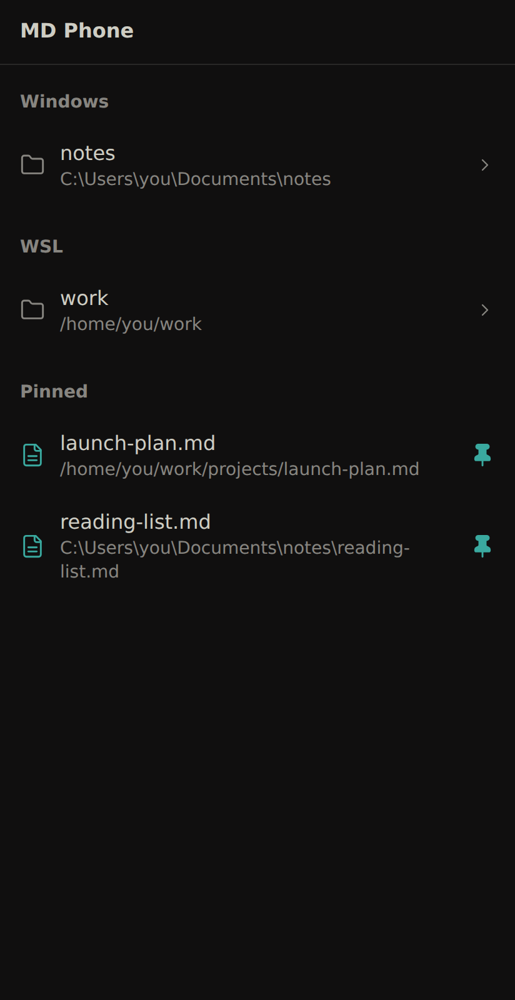</td>
    <td>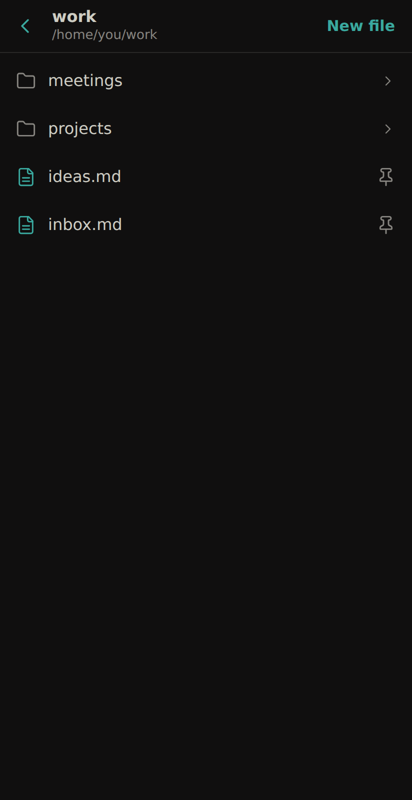</td>
    <td>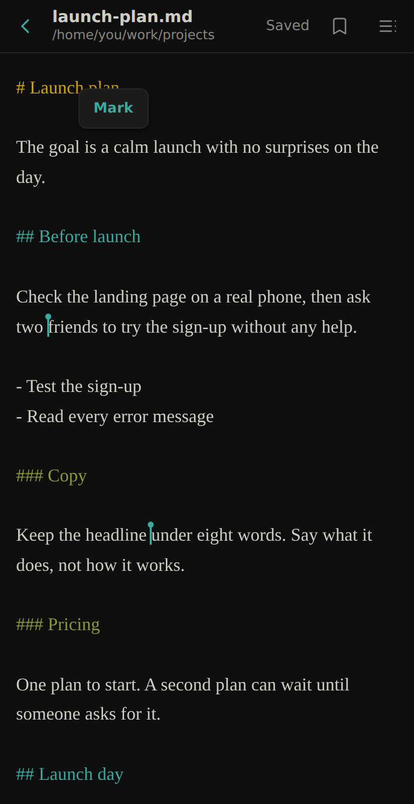</td>
    <td>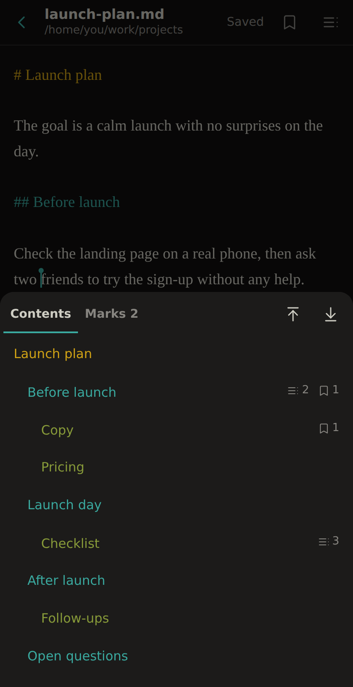</td>
  </tr>
  <tr>
    <td align="center">Home</td>
    <td align="center">Folder</td>
    <td align="center">Editor and marks</td>
    <td align="center">Contents</td>
  </tr>
  <tr>
    <td>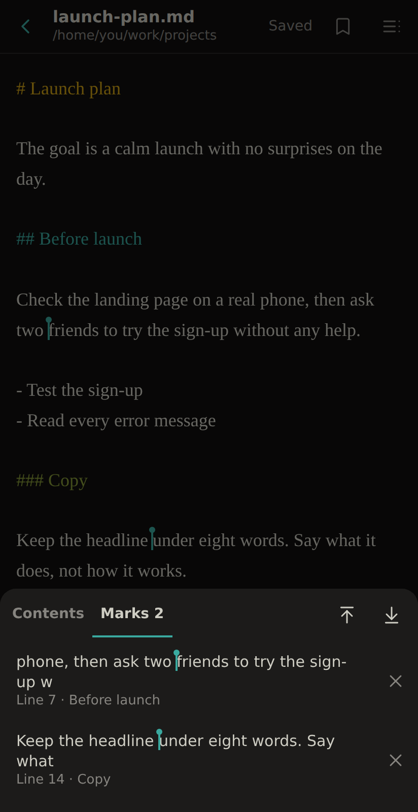</td>
    <td>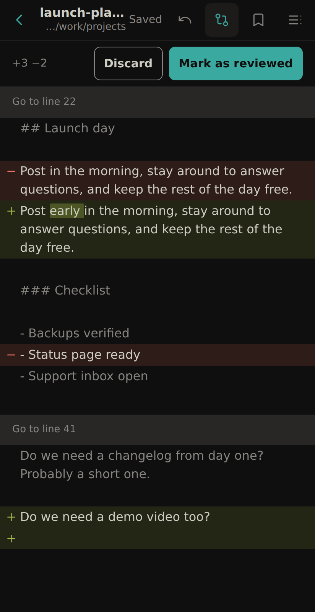</td>
    <td>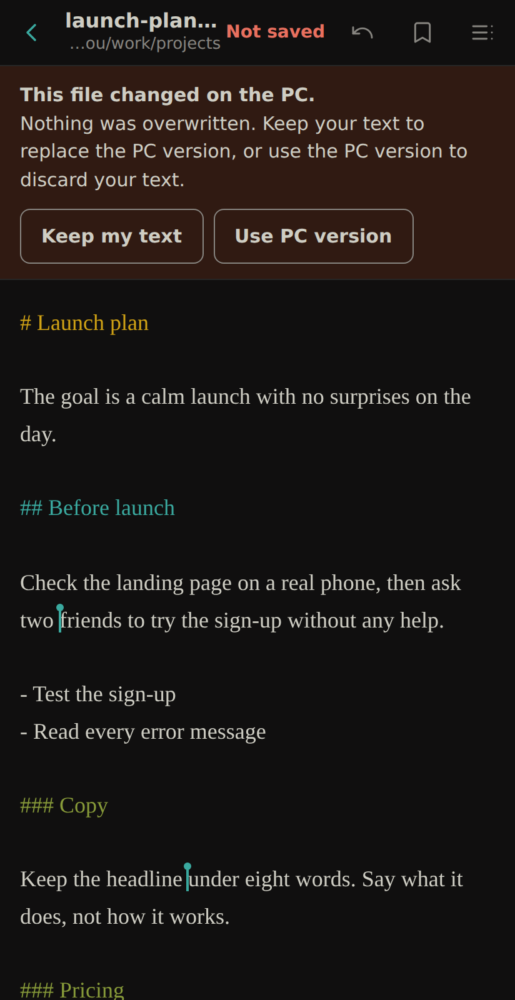</td>
  </tr>
  <tr>
    <td align="center">Marks</td>
    <td align="center">Changes</td>
    <td align="center">Conflict</td>
  </tr>
</table>

### Desktop

<table>
  <tr>
    <td>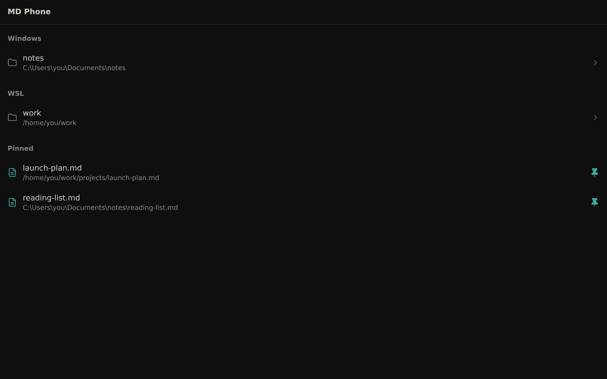</td>
    <td>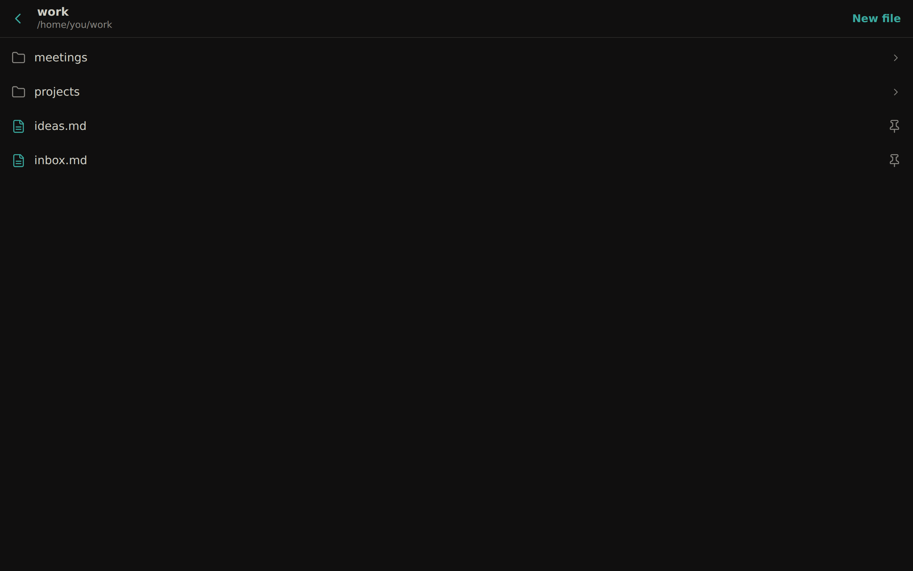</td>
  </tr>
  <tr>
    <td align="center">Home</td>
    <td align="center">Folder</td>
  </tr>
  <tr>
    <td>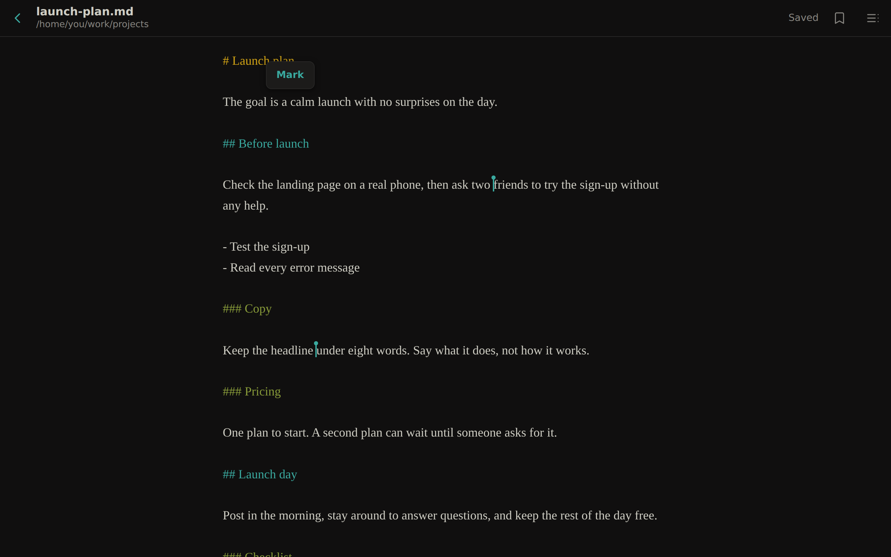</td>
    <td>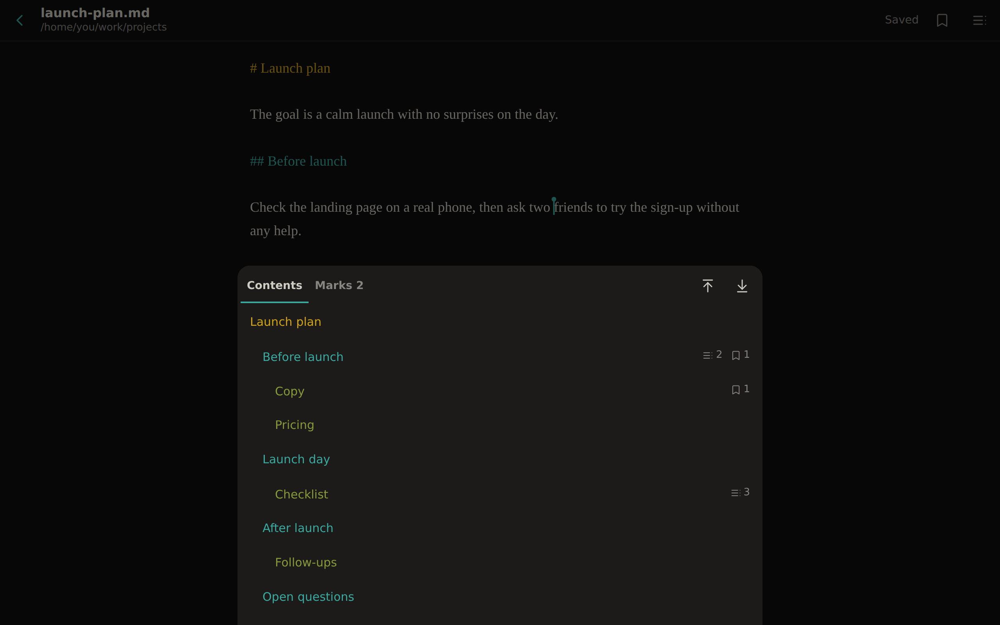</td>
  </tr>
  <tr>
    <td align="center">Editor and marks</td>
    <td align="center">Contents</td>
  </tr>
  <tr>
    <td>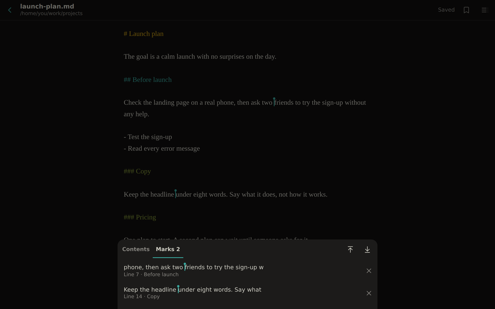</td>
    <td>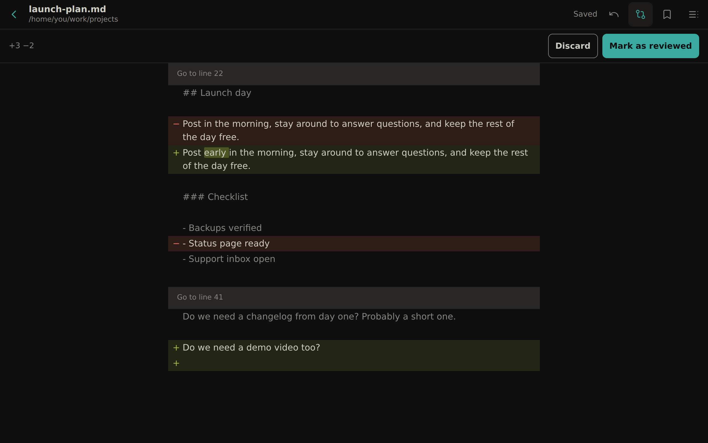</td>
  </tr>
  <tr>
    <td align="center">Marks</td>
    <td align="center">Changes</td>
  </tr>
  <tr>
    <td>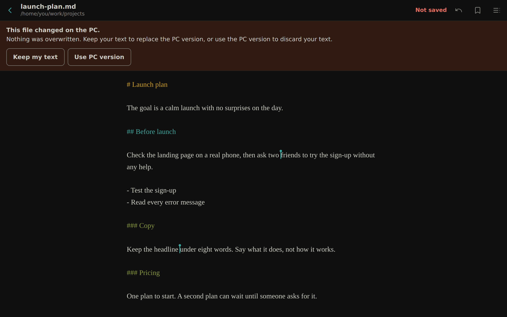</td>
  </tr>
  <tr>
    <td align="center">Conflict</td>
  </tr>
</table>

The notes and folder paths in these screenshots are made up.

## Features

- Browse folders you allow, grouped by Windows and WSL with their full paths, then open, edit or create `.md` files
- Autosave, with a draft kept on the phone if the connection drops
- Conflict detection through `ETag` and `If-Match`
- Keeps BOMs and Windows line endings, and refuses files that are not UTF-8
- Pin files to the top of their folder and to a Pinned section on the home screen (pins are stored in that browser)
- Contents sheet built from the note's headings, with jumps to the top and bottom (opens by itself on notes with 5 or more headings, and shows how many bullet points and marks each heading has)
- Colored headings that are display only, so nothing is added to the file
- GitHub-style word diff of what an AI or another program changed since you last reviewed the note. A note with changes opens straight at the first one, with one tap to accept or discard them (text typed in that browser isn't counted)
- Undo and redo buttons that also survive closing the tab, for when a whole block gets deleted by mistake
- Mark the exact cursor position from a button that floats at the cursor, and jump back from a Marks list (marks follow their character as you edit, and are stored in that browser)
- Each note reopens where you left it, and every folder and note has its own URL

## Setup

```powershell
git clone https://github.com/Gohans1/md-phone
cd md-phone
bun install
copy roots.example.json roots.json
```

Edit `roots.json` so each name points to a folder you want to edit. Then start the server:

```powershell
bun start
```

Expose it to your tailnet only:

```powershell
tailscale serve --bg --https=8444 http://127.0.0.1:4380
```

Open `https://<your-machine>.<your-tailnet>.ts.net:8444` on your phone.

To start it with Windows, put a shortcut to `start-hidden.vbs` in the `shell:startup` folder.

## Security

The server has no login. It listens on `127.0.0.1`, and Tailscale decides who can reach it, so anyone on your tailnet can edit every `.md` file under your `roots.json` folders. Never expose it with `tailscale funnel` or a public proxy, and allow only folders you are willing to edit from the phone.

## Tests

```bash
bun test
```

## License

[MIT](LICENSE)

`vendor/diff.js` is a minified build of [jsdiff](https://github.com/kpdecker/jsdiff), BSD-3-Clause, see `vendor/diff.LICENSE`. Rebuild it with `bun run vendor`.
